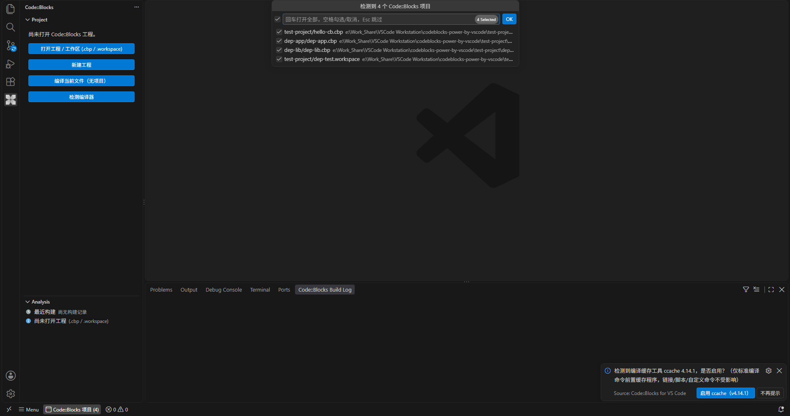
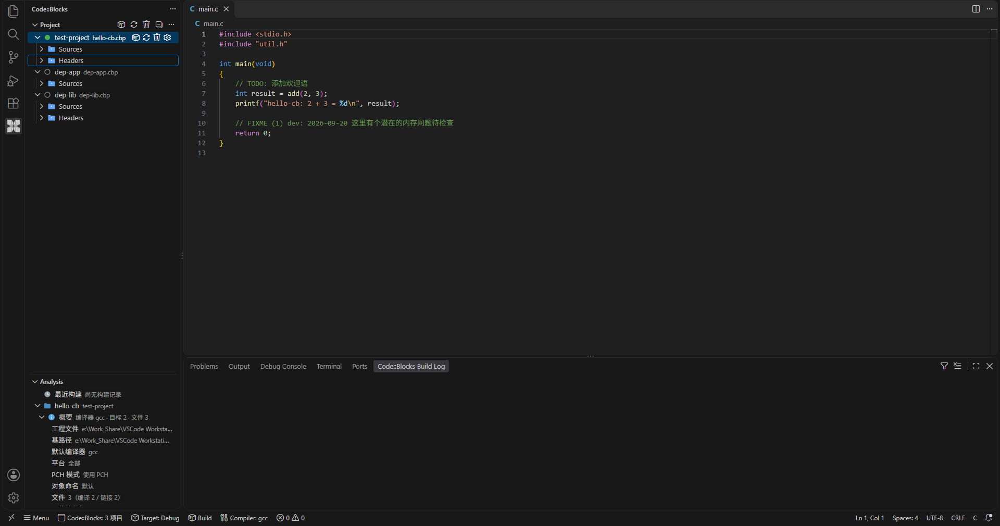
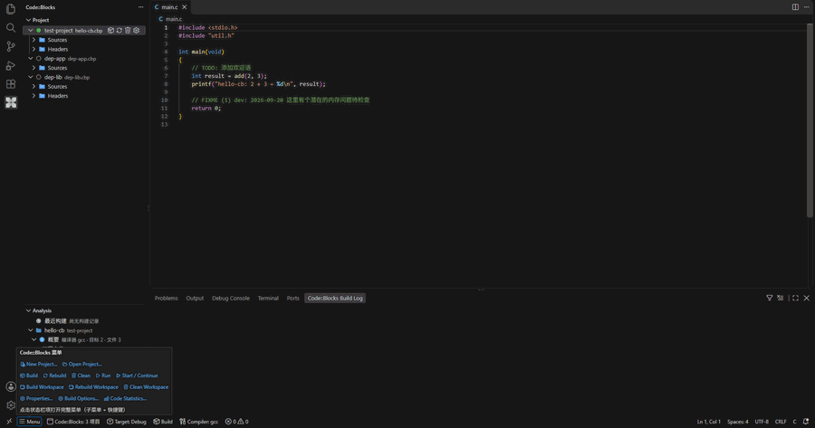
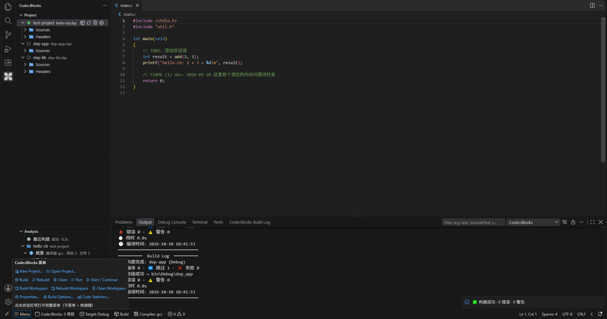
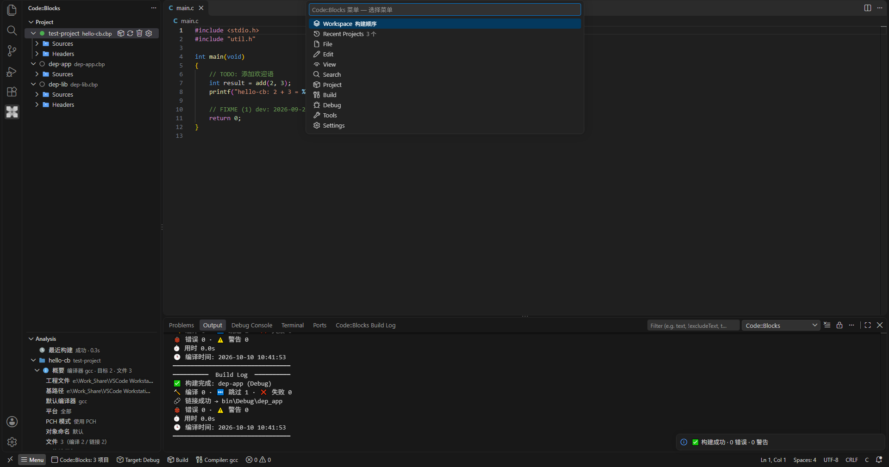
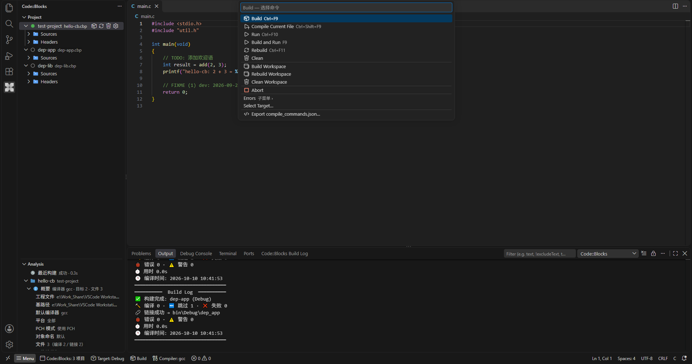

# Code::Blocks for VS Code

> Language: **English** ｜ [中文](./README.md)

An extension that natively ports the Code::Blocks core features to VS Code — a "mini IDE kernel" that drives GCC/GDB directly, **not** a `.cbp` → `tasks.json` bridge.

Open a `.cbp` / `.workspace` project directly in VS Code and get a build, debug, and project browsing experience aligned with Code::Blocks.

> **Author**: Robinmaomao ｜ **Version**: 0.8.132

[](LICENSE.md)

> **License note**: The TypeScript code of this extension is an independent rewrite (it does not copy GPL sources); however, the error regular-expression table (`resources/compilers/options_common_re.xml`) and the command templates (`resources/compilers/options_gcc.xml`) are derived from the GPL v3 Code::Blocks `compilergcc` resources, so the extension as a whole is released under GPL v3. See [LICENSE.md](LICENSE.md) for details.

> 📖 For a detailed feature tour, usage instructions, and a **complete RISC-V cross-compilation example**, see [Usage guide](docs/使用说明.md) (English: [Usage guide (EN)](docs/使用说明.en.md)); for item-by-item alignment evidence, see [Code::Blocks alignment reference](docs/对齐对照.md).

> **Unofficial notice**: This extension is an **independent rewrite and port** of Code::Blocks features by an individual community developer based on public information. It has **no affiliation, cooperation, or endorsement relationship** with the official Code::Blocks project or its authors / team, and does not represent their positions. The "Code::Blocks" name and logo are copyright their original authors; they are used here only to describe the feature set and compatibility target being modelled. Please report issues to [this repository](https://github.com/robinmaomao/vscode-codeblocks-emu/issues), **not** to the Code::Blocks team.
>
> **Disclaimer (unofficial)**: This is an unofficial, community-developed re-implementation of Code::Blocks features for VS Code. It is **not affiliated with, endorsed by, or sponsored by** the Code::Blocks project or its authors. "Code::Blocks" is used solely to describe the feature set it is modelled after. Please report issues to [this repository](https://github.com/robinmaomao/vscode-codeblocks-emu/issues), **not** to the Code::Blocks team.

## Screenshots

> All screenshots below were recorded from this extension running in real VS Code (the sample workspace is the [`test-project/`](test-project/) folder in this repository: 3 `.cbp` files + 1 `.workspace`).

### Opening a workspace: auto-detect and multi-select `.cbp` / `.workspace`



### Project tree · Project management · Project analysis



### Build: status bar menu → Build Workspace → live Build Log





### Code::Blocks menu (status bar `Menu`: 9 top-level menus + keybindings)





## Features

### Projects and builds

- 📁 **Native project parsing**: loads `.cbp` / `.workspace` directly (`fast-xml-parser`) and fully reconstructs the `Project` / `BuildTarget` / `ProjectFile` in-memory model, with support for virtual targets and virtual folders.
- 🔨 **Real build engine**: does not rely on `tasks.json`. Uses the built-in Code::Blocks command templates + macro expansion (`$compiler $options $includes ...`) and `spawn`s compile/link processes directly; incremental builds compare mtimes of source files + `#include` headers + link inputs.
- ⚙️ **Compiler management**: full parsing of `options_<id>.xml` (including `extends` inheritance, `<if platform>` platform branches, and `<Common>` references); auto-detects GCC / MinGW / Clang / MSVC / RISC-V as well as AVR / MSP430 / SDCC toolchains; reads **user-defined cross compilers** from the Code::Blocks `default.conf`.
- 🗂️ **Multi-project management**: open several `.cbp` files at once; the project tree supports drag-and-drop ordering (which sets the build order), move up/down, remove project, and active-project highlighting; opening a workspace auto-detects `.cbp` files, and a multi-select dialog (directory/file names, all selected by default) or the status bar entry reopens them at any time.
- 📂 **Project tree browsing**: multi-level nested directory tree rooted at the common top-level path (`relativeToCommonTopLevelPath`), file-type icons, missing-file markers, and directories sorted first (aligned with the VS Code Explorer).
- 🧩 **Context menu**: project nodes support incremental build / full rebuild / add files; file nodes support remove from project, open containing directory, and toggle compile/link (written back to `.cbp`).
- 📄 **Single-file build / single-file Clean**: right-click a file in the project tree → `Build File` (aligned with Code::Blocks `CompileFile`: DepsSearchStart + IsObjectOutdated incremental check, with a command byte-identical to the whole-target build) / `Clean File` (deletes the object and the `.depend` dependency files).
- ⏹️ **Stop a build at any time**: the ❌ button on the build notification or the `Code::Blocks: Stop Build` command; on Windows, `taskkill /T /F` kills the entire process tree (cmd → gcc → cc1/as/ld, no leftovers), and a cancellation is not counted as a failure.
- 🛡️ **Rebuild confirmation**: a modal confirmation dialog appears before Rebuild (aligned with Code::Blocks); a normal Build shows no dialog.
- 🚀 **Build semantics aligned with Code::Blocks (excerpt)** — item-by-item evidence in [Code::Blocks alignment reference](docs/对齐对照.md):
  - **File type detection** aligned with `FileTypeOf`: assembly sources (`.S`/`.s`/`.asm`/`.ss`/`.s62`) are compiled correctly and take part in linking; non-source files such as linker scripts (`.ld`) are neither compiled nor linked by default; `<Option buildCommand>` custom commands are recognized with `use="1"` semantics.
  - **Build sequencing**: pre/post-build scripts (`.bat` / commands, reading the system PATH live on Windows); project-level pre/post run once per build, target-level scripts run per target, and post-build is gated on "commands actually produced"; Rebuild = Clean + Build; banner order/wording and the up-to-date check align with the Code::Blocks state machine.
  - **Command lines and artifacts**: toolchain paths containing spaces are quoted automatically; objects passed to link/archive are quoted file by file (`QuoteStringIfNeeded`, so spaces in source files/subdirectories are not truncated); the object directory defaults to `.objs` when there is no `object_output` (aligned with `GetObjectOutput`); overlong command lines switch to a response file (`@file`); static library archiving deletes the old library before running ar; the object directory is created by `CreateDirRecursively` with the `GetCommonTopLevelPath` layout.
  - **Detail alignment**: library output file naming (`prefix_auto` / `extension_auto`, shared-library import library rules); path separators and artifacts such as `map.txt` (aligned with `wxPATH_NATIVE`); numeric target-type mapping (`-mwindows` distinguished correctly); `max_reported_errors` error truncation; GBK output decoding.
  - **Relink and macros**: forced relink on external dependencies (`external_deps` / `additional_output` / library mtime comparison, missing → WARNING) + compiler global search directories (`default.conf`) + project custom variable macro expansion; the full macro set is aligned with `MacrosManager::ReplaceMacros` (`$(#global variable[.member])`, built-in macros, environment variable fallback, `$$`/`%%` unescaping).

### Debugging (GDB)

- 🐞 **In-house inline DAP debug adapter**: drives `gdb -i=mi` directly — breakpoints (conditional / hit count / log), stepping (including instruction-level), variable inspection and modification (including nested members), call stack, threads, expression evaluation, disassembly view, Memory view, Registers view, data breakpoints, exception breakpoints, Run to Cursor, Set Next Statement, instruction breakpoints, attach to process, Detach, Add Symbol File, Send GDB Command (the Debug Console `-` prefix passes straight through to MI), multi-session routing (focused session first); plus a number of compatibility fixes for MinGW GDB 7.6.1–8.1 (program output forwarding, Step Out / conditional breakpoints / register reads, etc.); **F5 is wired up**: with no `launch.json`, debugging starts directly from the active project target, and `Code::Blocks GDB` also appears in `Select and Start Debugging`. See [Usage guide](docs/使用说明.md) for details.

### IntelliSense and symbols

- ✨ **IntelliSense completion**: generates `compile_commands.json` automatically (reusing the compile commands aligned with Code::Blocks, written to a cache outside the workspace and applied to the clangd user configuration; regenerated automatically after changing `codeblocks.clangd.*` or the compiler settings, and changing the compiler also restarts clangd to refresh open files), giving completion / go-to / hover / rename through clangd; when clangd is not installed it falls back to lightweight in-project symbol completion / hover / go-to.
- 🔍 **Symbol browser (Symbols)**: aligned with the Code::Blocks Symbols panel, groups project symbols into functions / macros / types / variables, and jumps to the exact location on click.

### UI and keybindings

- 🌐 **Chinese/English UI language**: static contributions (command titles / setting descriptions / view names) follow the **VS Code display language** (`package.nls.json` English default + `package.nls.zh-cn.json` Chinese); runtime strings (dialogs / QuickPick / status bar / WebView panel titles) are controlled by the **`codeblocks.ui.language`** setting (`auto` / `en` / `zh-cn`, default `auto`) and take effect **immediately**; you can also switch with the `Code::Blocks: Switch UI Language…` command (three-state choice + one-click window reload). See [Internationalization (i18n)](docs/国际化.md) for details.
- 🗂️ **Code::Blocks menu (status bar `Menu`)**: the nine menus File / Edit / View / Search / Project / Build / Debug / Tools / Settings — supports **submenu drill-down**, separators, and **keybinding labels**; the Build menu contains Compile Current File (Ctrl+Shift+F9), the Workspace trio (Build / Rebuild / Clean Workspace), Abort, Errors (previous/next/clear all), Select Target, Export compile_commands.json; related items are annotated when no project is open; hovering expands common command links in place.
- ⌨️ **Keybindings and conflict handling**: the default keys avoid all VS Code defaults (`Alt+G` Goto File / `Shift+F2` Project view / `Alt+F1-F2` error navigation / `Ctrl+Shift+R` Replace in Files and other CB keybindings); the `codeblocks.keybindings.cbStyle` setting enables **CB-faithful keybindings** (F5 toggle breakpoint, Ctrl+R replace, and 12 items in total, which override VS Code defaults and can be turned off at any time); the `Code::Blocks: Check Keybinding Conflicts` command scans built-in defaults / the user keybindings.json / other extensions and produces a conflict report.
- 🎛️ **Configurable keybindings**: the `codeblocks.keybindings.overrides` setting (30 items: build/debug/error navigation/project management + external aliases + the CB-faithful group) is the single source of truth, and changes are **written to the user keybindings.json automatically** (custom keys + removal rules for the default keys; managed entries only, comments preserved, first-time backup, read-back validation with rollback); a **visual settings panel** is also provided (`Code::Blocks: Keybinding Settings`: key capture input, inline conflict/effective status, conflict check, profile import/export).
- 🎨 **Dedicated syntax highlighting**: dedicated TextMate grammars for linker scripts (`.ld` / `.lcf`), GNU assembly (`.S` / `.s`, RISC-V), and `.xm` configuration scripts; installation writes token color rules that apply only to these files and do not override other user color themes; assembly line comments default to `//` (safe for preprocessed `.S`), and the `codeblocks.editor.asmHashComment` setting switches back to GAS-native `#` (recommended when assembling native `.s` directly).

### Logs and output

- 📋 **Structured Build Log**: a build summary tree (compiler / compile statistics / link result + **Errors (N) / Warnings (N) groups**, with diagnostics on the level below the group), and clicking a diagnostic node jumps to the exact line and column; `F4` / `Shift+F4` cycle through errors.
- 🖥️ **Build output**: single-line completion-style progress (`✔️ [Compiled] 123-248 xxx.c (2.0s)`) plus `[Skipping]` / `[Linking]` / `[Archiving]` states; when a build finishes, an emoji summary block is appended at the end of the output (compiled/skipped/failed, link result, error/warning counts, elapsed time, slowest Top 3, compile time). The Output channel uses normal mode by default (cleared on window reload; warnings marked `⚠️` / errors marked `❌` in text); `codeblocks.build.persistLog` switches it to a log channel (severity coloring, history kept across windows; switching requires a window reload, and changing it shows a reminder + one-click reload), and `codeblocks.build.outputTimestamp` adds a timestamp to every line in the normal channel.

### Tools

- 📊 **Helper tools**: code statistics, TODO scan, AStyle formatting, **Tidy comments**, **header guards** (including auto-insert for new files), **Swap Header / Source**, **custom tools** (Configure tools: `codeblocks.tools` + dynamic Tools menu entries), **show compiler commands**, **Makefile export**, **project import** (Dev-C++ / VC6 / VS2010+ → `.cbp`), **workspace dependency editing** (with cycle detection), **Open default.conf** (entry point for editing global settings by hand).

## ⚠️ Known limitations (unsupported features)

The following Code::Blocks features have not been ported yet; the extension warns explicitly or skips when it encounters the related configuration:

| Feature | Description |
|------|------|
| **Squirrel build scripts** (`<Script file="*.script"/>`) | The Squirrel script engine is not ported; the build prints a warning and skips them |
| **makefile project mode (partial)** | Build / Rebuild / Clean run a subset of `<MakeCommands>` (including `execution_dir`); DistClean and single-file builds are not wired up |
| **`<if exec>` conditions in compiler XML** | Evaluation by running an external program is not implemented (simplified to return default; the built-in gcc / clang XML do not use this branch) |
| **console runner** | The Code::Blocks cb_console_runner is not ported (the integrated terminal is equivalent) |
| **default.conf global settings editing** (B1/B2/C4) | Decided against after evaluation: default.conf is Code::Blocks' own private configuration (CB rewrites the whole file on exit/when opening settings, so write races cannot be eliminated); global directories/options/libraries/variables are already read and applied in full. Alternative: `Settings → Default Config…` to open the file and edit it by hand |

> The complete limitation list, behavior differences, and alternatives are in [Usage guide](docs/使用说明.md) §16 and [Code::Blocks alignment reference](docs/对齐对照.md).
> Some Code::Blocks tools (CppCheck / regex test bench / nm viewer, etc.) are not re-implemented in this extension; use mature VS Code extensions instead (see §16.1 of the user guide).

## Installation

> Requires VS Code **1.85.0+**; if features do not work after installing or updating, run **Reload Window**.

### Option 1: install from the VS Code Marketplace (recommended)

Search for **Code::Blocks for VS Code** in the VS Code Extensions view, or:

```powershell
code --install-extension robinmaomao.codeblocks-vscode
```

### Option 2: install from GitHub Releases

Download the latest `codeblocks-vscode-0.8.132.vsix` from [Releases](https://github.com/robinmaomao/vscode-codeblocks-emu/releases):

```powershell
code --install-extension codeblocks-vscode-0.8.132.vsix --force
```

### Option 3: build from source

```powershell
npm install
npm run package
code --install-extension codeblocks-vscode-0.8.132.vsix --force
```

> `npm run package` = `vsce package` (packaging runs the `vscode:prepublish` hook automatically = `tsc` compile (`dist/`, for local tests) + esbuild single-file bundle (`bundle/extension.js`, the release entry)); running `npx vsce package` / `npx vsce publish` directly also builds automatically and never packs a stale or missing `bundle/`; on Windows, prefer `npm.cmd` / `npx.cmd` (PSReadLine execution policy).

### Development and debugging

```powershell
code --extensionDevelopmentPath="." --disable-extensions --new-window
```

## Usage

### Quick start

1. Open a folder containing `.cbp` / `.workspace` (projects are detected automatically and you are prompted to choose which to open), or run **`Code::Blocks: Open Project (.cbp)`** from the Command Palette.
2. Click the **Code::Blocks** icon in the activity bar on the left to expand the panels:
   - **Project**: project tree (multiple projects + nested directories + file browsing; hovering a project row shows Build / Rebuild / Clean / Properties shortcut buttons)
   - **Analysis**: project analysis (shows the important `.cbp` properties per project; hover to see the corresponding configuration fragment, click to locate it in the `.cbp`, right-click to copy; the top is the "recent builds" entry)
   - **Symbols**: symbol browser (hidden by default; bring it up from ⋯ → Views or control it with the `codeblocks.ui.symbolsView` setting)
   - **Build Log**: structured build summary, in the **"Build Log" tab of the bottom panel** (`Ctrl+J` to open)
3. The leftmost status bar item is **`⊞ Menu`** (the Code::Blocks menu bar: click to open the two-level menu, hover to expand common command links in place).
4. The status bar also has the **build target (Target)**, **build menu (Build)**, and **compiler (Compiler)**; the build menu contains Build / Rebuild / **Build Workspace** / **Rebuild Workspace**; clicking the Build item while a build is running stops it.

> Views can be dragged and resized freely, and VS Code saves and restores them automatically; the **`Code::Blocks: Reset View Layout`** command restores the default layout in one click.

### Building

- **Build**: `Ctrl+F9`; or status bar `Build` → `Build` / menu `Build → Build`
- **Rebuild**: `Ctrl+F11`; or status bar `Build` → `Rebuild` / menu `Build → Rebuild` (runs after a **confirmation dialog**)
- **Compile current file**: `Ctrl+Shift+F9`, or menu `Build → Compile Current File`
- **Clean**: menu `Build → Clean` (no default shortcut)
- **Build and run**: `F9`
- **Run**: `Ctrl+F10`
- **Stop build**: the ❌ button on the build notification, or the `Code::Blocks: Stop Build` command

> Builds are **incremental** (mtimes of source files and `#include` headers are compared, so a header update also triggers recompilation); `Rebuild` is aligned with Code::Blocks and cleans the object directory before a full recompile. Updating a linked library/external dependency (`external_deps`) triggers a relink automatically; a pure incremental build after a Rebuild does not run post-build scripts again (aligned with Code::Blocks).

### More usage

Project tree operations (multi-project drag ordering / per-file compile·link toggles / single-file Build·Clean), error navigation (`F4` / `Shift+F4`), the full keybinding and command reference, and panel descriptions are in **[Usage guide](docs/使用说明.md)** (§3 UI / §6 Build / §11 Keybindings / §13 Settings) — this README does not duplicate them.

## Configuration (common settings)

| Setting | Default | Description |
|--------|--------|------|
| `codeblocks.compilerId` | `gcc` | Default compiler ID (maps to `options_<id>.xml`) |
| `codeblocks.masterPath` | `` | Compiler installation root (empty = detect from PATH) |
| `codeblocks.parallelJobs` | `0` | Number of parallel compile jobs (0 = automatic: logical cores × 2, at most 32) |
| `codeblocks.saveBeforeBuild` | `true` | Save automatically before building |
| `codeblocks.compilerPrograms` | `{}` | Full paths of compiler programs (cross compilers are written by detection) |
| `codeblocks.astyleOptions` | `["--style=allman", "--indent=spaces=4"]` | AStyle formatting options |
| `codeblocks.maxReportedErrors` | `50` | Maximum number of errors collected per build (0 = unlimited) |
| `codeblocks.build.verboseOutput` | `false` | Verbose build output: full compile command lines, per-file delete list for Clean, incremental skip list (aligned with Code::Blocks verbose mode) |
| `codeblocks.build.profile` | `false` | Build performance probe: prints a `[profile]` phase timing block at the end of the build (equivalent to `CB_BUILD_PROFILE=1`) |
| `codeblocks.build.skipIncludeDeps` | `false` | Incremental builds skip `#include` header dependency scanning (aligned with the Code::Blocks /skip_include_deps setting) |
| `codeblocks.build.compilerCache` | `none` | Compiler cache (ccache/sccache, an additive safeguard, off by default): when enabled, only standard compile commands get the cache program prefixed (link/resource/script commands are not injected); if the tool is not found the build falls back to the original compiler (the build does not fail); the "Install Compiler Cache (ccache/sccache)…" command provides installation guidance |
| `codeblocks.build.compilerCachePath` | `` | Explicit path to the compiler cache tool (empty = detect PATH and common install directories; an invalid explicit path is treated as not found) |
| `codeblocks.build.cleanResponseFiles` | `false` | Delete response files in the object directory on Clean/Rebuild (`*.respFile`, the `@file` temporary input for overlong commands); off by default = aligned with CB, which does not clean them, enable to avoid leaving old files behind permanently |
| `codeblocks.build.scriptExitGraceMs` | `1500` | **Grace limit** for pre/post-build script termination (ms, 0–60000): after the command itself exits, continue as soon as the pipe has been quiet for about 250 ms, and never wait longer than this value; if the pipe closes in the meantime, continue immediately. Code::Blocks waits only for the command itself → set `0` for exact alignment (background programs `start`ed or daemons inside the script no longer slow down post-build); if you need to wait for a background program to finish, use a foreground command or `start /wait` |
| `codeblocks.build.scriptCommandTimeoutMs` | `0` | Timeout for a single pre/post-build script command (ms, 0 = no timeout, consistent with the unlimited wait in Code::Blocks; maximum 3600000): on timeout the entire process tree of the command is killed and the build is marked failed; useful for blocking scenarios such as network drive (SMB) reconnects or upload services (.NET default 100s timeout) inside scripts; while the script runs, a "still running" heartbeat line is printed every 5 s |
| `codeblocks.clangd.enabled` | `true` | Whether to enable the clangd integration (generate `compile_commands.json` automatically and update the clangd user configuration); when off it falls back to lightweight completion and reminds you that "existing fragments from this extension will still be read by clangd" (you can open the configuration to clean them up) |
| `codeblocks.clangd.buildLogDiagnostics` | `build` | Diagnostic source for the Build Log when clangd is detected: `build` = complete diagnostics from the build engine (default); `clangd` = clangd diagnostics (opened files only) |
| `codeblocks.clangd.forcedIncludes` | `["global.h"]` | Base header names force-included when clangd analyzes headers (default `global.h`: typedef/macro/sfr/clib context; do not use a full master header such as `include.h`, or recursive inclusion produces false positives) |
| `codeblocks.clangd.suppressedWarnings` | `["-Wunused-function", "redefinition_different_typedef"]` | Diagnostics suppressed in clangd output (`-W` group names or diagnostic names): by default suppresses cross-boundary false positives from embedded SDKs — compile-time assertions in static functions (`-Wunused-function`) and typedef conflicts between SDK headers and toolchain system headers (`__int32_t`, etc.); remove an entry to show it again |
| `codeblocks.clangd.suppressHeaderDiagnostics` | `true` | Suppress all diagnostics when a header (`.h`) is analyzed on its own (SDK headers are not self-contained and produce many false positives; `.c` diagnostics are unaffected) |
| `codeblocks.clangd.unusedIncludes` | `none` | Writes `Diagnostics.UnusedIncludes`: `none` disables the hint (default) / `strict` enables it / `omit` does not write the key (leave it to the clangd default or your configuration) |
| `codeblocks.clangd.headerInsertion` | `never` | Writes `Completion.HeaderInsertion`: `never` never auto-inserts `#include` on completion (default) / `iwyu` the clangd default behavior / `omit` does not write the key |
| `codeblocks.clangd.indexBackground` | `default` | Writes `Index.Background`: `default` does not write it / `skip` builds no background index (saves CPU/memory on large SDKs) / `build` enables it explicitly |
| `codeblocks.clangd.indexStandardLibrary` | `default` | Writes `Index.StandardLibrary`: `default` does not write it / `false` does not pre-index the standard library (saves memory on bare metal) / `true` enables it explicitly |
| `codeblocks.clangd.clangTidy` | `default` | `default` does not write it / `off` writes `Diagnostics.ClangTidy.Remove: ['*']` to disable all clang-tidy checks |
| `codeblocks.clangd.completionAllScopes` | `default` | Writes `Completion.AllScopes`: `default` does not write it / `no` suggests only the visible scopes / `yes` enables it explicitly |
| `codeblocks.clangd.inlayHints` | `default` | Writes `InlayHints.Enabled`: `default` does not write it / `off` disables inlay hints / `on` enables them |
| `codeblocks.clangd.documentationCommentFormat` | `default` | Writes `Documentation.CommentFormat`: `default` does not write it / `doxygen` shows parameter and return value docs on hover / `markdown` / `plaintext` |
| `codeblocks.clangd.excludeDirs` | `[]` | Writes `If.PathExclude`: files under these directory names (e.g. `obj`, `bin`) do not use this project fragment |
| `codeblocks.clangd.builtinHeaders` | `clangd` | Writes `CompileFlags.BuiltinHeaders`: `clangd` uses the clangd built-in headers (default) / `queryDriver` uses the cross compiler's built-in headers (with `--query-driver`) |
| `codeblocks.clangd.queryDriver` | `false` | When enabled, warns in the Output channel if `clangd.arguments` lacks `--query-driver` (the `Configure clangd --query-driver` command writes it in one click) |
| `codeblocks.clangd.extraConfig` | `""` | Free-form YAML injected as a **trailing** fragment in the same scope (can override any key written by the extension; the extension adds `If.PathMatch` automatically) |

> The complete set of 77 settings (7 sections, bilingual descriptions) is in [Usage guide](docs/使用说明.md) §13. There are also two clangd commands: `Code::Blocks: Clean Stale clangd Config Fragments` (cleans stale fragments + orphan cache directories, with a preview before confirming) and `Code::Blocks: Configure clangd --query-driver` (cross-compiler fidelity).

## Architecture

```
.cbp / .workspace (XML)
   → model/parser.ts        ProjectParser（.cbp/.workspace 解析）
   → model/types.ts         数据模型（TargetType / Project / BuildTarget / ProjectFile）
   → compiler/optionsLoader.ts   options_<id>.xml 完整解析（extends / 平台条件）
   → compiler/commandGenerator.ts  宏展开 + 命令行生成
   → build/buildEngine.ts    构建引擎（增量编译 + 派生进程 + 对象目录创建）
   → build/outputParser.ts   错误/警告解析 → VS Code Diagnostics
   → debug/gdbDebugAdapter.ts  DAP 调试适配器 → GDB MI
   → ui/projectTreeProvider.ts  工程树视图
```

### Source layout

```
src/
├── extension.ts             扩展入口（命令注册 / 构建编排 / 状态栏）
├── model/                   .cbp/.workspace 解析 + 数据模型 / 虚拟文件夹 / 属主索引
├── compiler/                编译器模型 / 选项 XML 解析 / 命令生成 / 工具链探测
├── build/                   构建引擎 / 输出解析 / 脚本执行 / 编译缓存适配
├── debug/                   GDB MI 会话 / DAP 适配器 / 远程调试
├── tools/                   TODO 扫描 / 代码统计 / AStyle / 快捷键配置
└── ui/                      工程树 / 分析 / 菜单 / WebView 面板
```

## Cross compilers (RISC-V, etc.)

The extension reads the Code::Blocks "user-defined compilers" (`/compiler/user_sets/<id>`) from `%APPDATA%\CodeBlocks\default.conf` and resolves the executable paths of `C_COMPILER` / `LINKER` etc. automatically. Projects whose `.cbp` uses a custom compiler ID such as `compiler="riscv32-elf"` therefore build directly with no extra configuration.

## License

[GPL v3](LICENSE.md). This project ports core logic from the Code::Blocks sources (LGPL/GPL v3); `resources/compilers/*.xml` is derived from GPL v3 sources.
