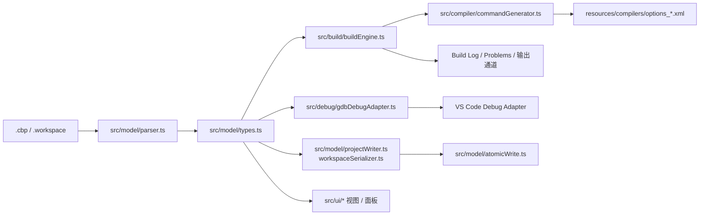

# 架构与模块地图

> 目的：给后续功能开发一个稳定的落点说明。本文只描述**当前实现**与**已规划的拆分边界**，不重复用户文档。
> 基线：0.8.158（Profiler 命令拆分后）。

## 1. 数据流

- `.cbp` / `.workspace` 只经 `parser` 进入模型；保存只经 `projectWriter` / `workspaceSerializer`。
- 构建命令由 `commandGenerator` 生成，`buildEngine` 负责状态机、进程执行与诊断解析。
- 调试由 `gdbDebugAdapter` 直接驱动 GDB/MI，DAP 事件交给 VS Code。
- 所有工程文件写入必须走 `atomicWrite.writeFileAtomicSync`（避免截断）。

## 2. 目录职责

| 目录 | 职责 | 备注 |
|---|---|---|
| `src/model/` | `.cbp`/`.workspace` 模型、解析、序列化、原子写、XML 转义 | 纯逻辑优先，避免依赖 vscode |
| `src/compiler/` | 编译器 XML 加载、元数据（显示名/master 路径）、命令生成、宏展开、探测、缓存 | 与 CB `compilergcc` 对齐；`compilerMetadata.ts` 不执行 registry/外部命令 |
| `src/build/` | 构建状态机、输出解析、诊断、脚本、Makefile、无工程编译 | 可独立单测 |
| `src/debug/` | GDB/MI 会话、DAP 适配器、内存格式化 | 通过 `debugRegistry` 与 UI 解耦 |
| `src/project/` | 新建/导入/模板、递归添加、单元文本手术、workspace 写入 | 文件级操作 |
| `src/search/` | 工程内搜索、历史、worker | 只搜索已打开 `.cbp` |
| `src/tools/` | AStyle、TODO、书签、编码、clangd、Profiler、SymTab、Copy Strings、LRU | 多数为纯函数或可注入依赖 |
| `src/ui/` | TreeView / WebView 面板 / 状态栏菜单 | 展示层；面板含内联 HTML |
| `src/ui/webview/` | WebView 公共运行时（nonce/CSP/HTML 转义/JSON 注入） | 新面板必须复用 |
| `src/features/` | 从 `extension.ts` 拆出的命令/功能模块 | 通过依赖注入访问共享状态 |
| `src/extension.ts` | 激活、命令注册、共享状态编排（组合根） | 目标：只保留编排，不放大段实现 |

## 3. Feature 模块约定

从 0.8.155 起，新增/迁移的命令尽量放到 `src/features/`：

1. 导出 `registerXxxCommands(context, deps)`；
2. `deps` 只暴露该功能需要的 getter/回调，不直接 import `extension.ts`（避免循环依赖）；
3. 纯逻辑放 `src/tools/` / `src/model/`，feature 模块只做 vscode 接线；
4. 每个 feature 至少一个无头测试（纯逻辑）或宿主测试（命令注册/交互）。

已迁移示例：[toolCommands.ts](../../src/features/toolCommands.ts)（Copy Strings / Backtick Cache）、[workspaceCommands.ts](../../src/features/workspaceCommands.ts)（Save Project As / Workspace 生命周期）、[newProjectCommands.ts](../../src/features/newProjectCommands.ts)（New Build Target / New File）、[debugCommands.ts](../../src/features/debugCommands.ts)（Next Instruction / Examine Memory）、[autoVersioningCommands.ts](../../src/features/autoVersioningCommands.ts)（AutoVersioning 命令 + 构建钩子）、[profilerCommands.ts](../../src/features/profilerCommands.ts)（Profiler 运行/报告导出）。

## 4. 拆分路线（P3-1）

| 批次 | 目标 | 状态 |
|---|---|---|
| 1 | 纯逻辑模块：atomicWrite / xml / workspaceSerializer / noProjectCompile / memoryDump / copyStrings / profiler / symtab | ✅ 0.8.154 |
| 2 | 工具类命令拆到 `src/features/toolCommands.ts` | ✅ 0.8.155 |
| 2b | Profiler 命令编排拆到 `src/features/profilerCommands.ts` | ✅ 0.8.158 |
| 3 | 工程生命周期（open/close/reload/workspace/recent/status bar）→ `features/projectManager.ts` | ◐ 0.8.155：workspace 生命周期 + New 命令已拆出；open/close/reload/recent/status bar 待拆 |
| 4 | 构建/运行/清理/编译命令 → `features/buildCommands.ts` | ☐ 待排期 |
| 5 | 调试辅助命令/寄存器/内存 → `features/debugCommands.ts` | ◐ 0.8.155：指令级步进 / Examine memory 已拆出；寄存器/attach/detach 等待拆 |
| 6 | 菜单/面板/设置入口 → `features/uiCommands.ts` | ☐ 待排期 |

每批只移动代码、不改行为；每批独立 PR，跑 `npm test` + `test:contract` 后再进入下一批。

## 5. WebView 约定

- 所有内联 `<script>` 必须带 `nonce`，CSP 用 `cspMeta(nonce)`（`src/ui/webview/common.ts`）。
- 动态数据注入脚本使用 `jsonForScript()`，禁止把未转义 JSON 直接拼进模板。
- 面板 HTML 变更后必跑：`test-html-syntax.js`、`test-webview-panels.js`、`test-i18n-webview.js`。
- 客户端 `esc()` 仍保留在模板内（沙箱脚本无法 import 宿主模块）；宿主侧 HTML 拼接使用 `escapeHtml`。

## 6. 性能基线

- 激活耗时：`[Code::Blocks] Activation completed in {0}ms`（输出通道 debug 级）。
- `detect.autoOpen=off` 时激活/工作区变化跳过全量 `findFiles`，仅保留状态栏入口与增量 watcher。
- compile/link 右键切换只更新模型字段并刷新单节点（`projectTreeProvider.refreshFile`），不再重解析整个工程。
- 构建/解析基准见 [性能基准](../testing/performance-baseline.md)，预算门禁按 `min` 判定。
